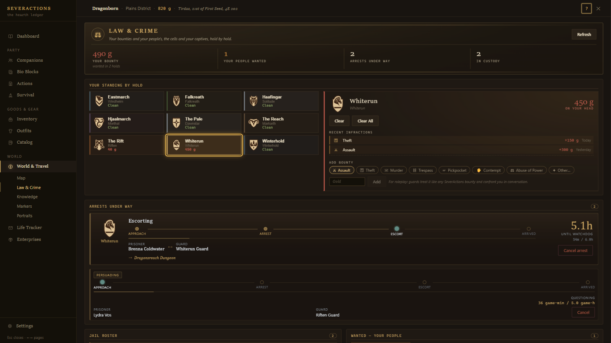
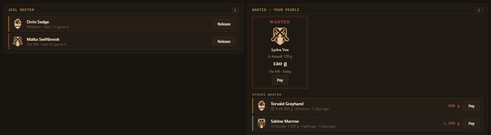
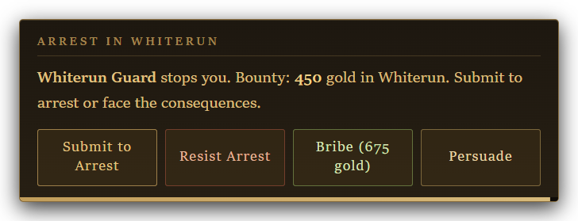
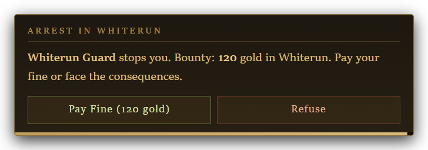
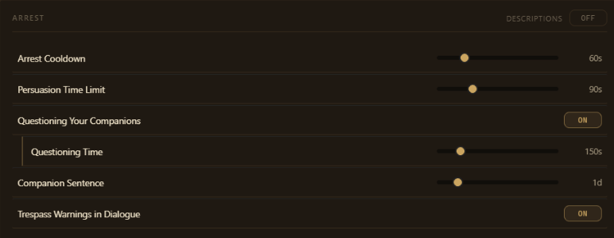

# Crime and the Law: A Player's Guide

*Written for SeverActions 4.7. Every picture here is an example built from made-up people and numbers.*

This guide covers SeverActions' guards, bounties and jails:

- **Your own bounty:** what guards know, and what happens when one stops you.
- **Other people's crimes:** getting an NPC charged, arrested, judged or jailed, and getting them out again.
- **Your companions:** what happens when a guard comes for one of your people.

| I want to... | Go to |
|---|---|
| See what I'm wanted for | [The Law & Crime page](#the-law--crime-page) |
| Get out of an arrest | [When a guard stops you](#when-a-guard-stops-you) |
| Clear my bounty | [How do I clear my bounty?](#how-do-i-clear-my-bounty) |
| Have someone arrested | [How do I get someone arrested?](#how-do-i-get-someone-arrested) |
| Get someone out of jail | [Getting someone out](#getting-someone-out) |
| Keep my companion out of jail | [Part 3: Your companions](#part-3-your-companions) |
| Fix something | [Why isn't this working?](#why-isnt-this-working) |

## Before you start

**Open the menu.** Press **Shift+8**. You can change the key in Settings → Hotkeys.

**Check your install.** Both arrest options are **not ticked by default**. Without them, the menu pages still work, but nobody does any of this in conversation.

| Installer option | Page | Ticked by default? | What you lose without it |
|---|---|---|---|
| **Arrest Actions** | Action Modules | **No, tick it yourself** | Guards arresting, charging or sending for anyone, jarls ordering arrests, judgments, pleas, and questioning your companions. |
| **Arrest/Crime Prompts** | Prompt Modules | **No, tick it yourself** | Guards knowing your bounty and what it is for, prisoners knowing they are locked up, and the context guards need to judge a plea or question a companion. |

If you skipped either, run the installer again and tick it. The trespass prompt is always installed and has no option.

**Know how talking works.** There are no fixed dialogue lines. The AI plays each guard and acts when a matter is truly settled in that conversation, so:

- **Say plainly what you want.** "Arrest that man for theft" works better than hints.
- **Get a clear yes.** A guard who only threatens you has not arrested you.

The sample lines in this guide are ideas, not magic words.

---

# Part 1: Your own bounty

## The idea in one minute

SeverActions keeps **its own bounty for you in each hold**, separate from the game's. Guards, jarls, housecarls and stewards of that hold know about it, and they know **what it is for**: "assault (300 gold), theft (150 gold)".

The game's own crime system still runs beside it. A crime the game sees for itself (a guard watching you steal) gives you a normal bounty, and normal guards deal with it the normal way. SeverActions' bounty only comes from the people in this guide, and the game's guards never see it on their own.

**Who can charge you:** a guard, a jarl or a housecarl, for a crime they saw just now or for contempt. Stewards know your bounty but can't add to it. The amount is the AI's choice, usually in line with the crime: about a hundred gold for trespass, one to three thousand for murder.

**A jarl or housecarl can also order your arrest.** If you owe nothing in that hold, the guard charges you 300 first.

## The Law & Crime page

Open **World & Travel → Law & Crime**.

*Example with made-up data: your bounty in each hold, what you are wanted for in the selected hold, and the arrests under way.*

| Part of the page | What it shows |
|---|---|
| **Your bounty** and the counts beside it | Your total bounty, how many of your people are wanted, arrests under way, and people in custody. |
| **Your standing by hold** | One tile per hold. Click a tile to see its bounty, its **Recent infractions**, and **Clear**. |
| **Add bounty** | Puts a bounty on yourself, for roleplay. Guards treat it like any other. |
| **Arrests under way** | Every arrest happening now, with **Cancel**, which lets the prisoner go. |
| **Jail roster** | Everyone SeverActions has locked up, with **Release**. |
| **Wanted** | Your people with a bounty first, then everyone else wanted, each with **Pay**. |

*Example with made-up data: two prisoners, a companion wanted for assault, and two other wanted people.*

**Clear** and **Clear All** wipe SeverActions' bounty only. They don't touch the game's own bounty. **Clear All** only appears when you are wanted in more than one hold.

## When a guard stops you

A guard with a reason (a SeverActions bounty on you in their hold) can decide in conversation to arrest you. When they do, a card appears:

*Example with made-up data: a 450-gold bounty, at or above the threshold, so the card offers all four choices.*

| Button | What happens |
|---|---|
| **Submit to Arrest** | You go to jail. See [Jail](#jail). |
| **Resist Arrest** | Your bounty goes up by **500** and the guards of that hold turn on you. See [Resisting](#resisting). |
| **Bribe** | You pay **1.5 times** your bounty and walk free. |
| **Persuade** | You get **90 seconds** to talk your way out. See [Persuading a guard](#persuading-a-guard). |

**Under 300 gold** the card is smaller:

*Example with made-up data: a 120-gold bounty, below the threshold.*

| Button | What happens |
|---|---|
| **Pay Fine** | You pay the bounty and walk free. |
| **Refuse** | The same as Resist Arrest: +500 and a fight. |

Things to know about the card:

- **It has a 60-second timer. If it runs out, you submit and go to jail.**
- Escape closes it, but it comes back a couple of seconds later while the guard is still on you.
- If you can't afford a fine or bribe, the guard won't take money again for the rest of that arrest. Those buttons go away, and on the small card **Submit to Arrest** takes the place of Pay Fine.
- Paying clears the bounty you had when the card opened. Anything charged while it was open is still owed.
- Paying, or persuading the guard, also clears the game's own non-violent bounty in that hold. A violent bounty the game gave you stays.
- After a guard stops you, no guard can try again for **60 seconds**.

The 300-gold line, the 1.5 bribe and the 500 penalty can be changed on the MCM's Crime & Bounty page. See [Settings at a glance](#settings-at-a-glance).

### Persuading a guard

1. Click **Persuade**. You will see "You have 90 seconds to convince the guard".
2. The guard follows you. Talk to them and make your case: why you did it, who you are, what you can offer.

   > "I took the bread to feed my sister. Let me make it right with the baker."

3. The guard decides. They weigh how big the bounty is, your standing, the crime, their own nature, and what you offer.

| Outcome | What happens |
|---|---|
| **The guard is convinced** | "The guard lets you go with a warning." **Your whole bounty in that hold is cleared.** |
| **The guard is not convinced** | The card comes back without Persuade. |
| **Time runs out**, or you walk more than a short distance from the guard | "The guard has lost patience!" The card comes back without Persuade. |

You get one try per arrest, and only at or above 300 gold. A guard won't decide on your first line, so keep talking.

### Resisting

Your SeverActions bounty grows by 500, and **all of it** becomes the game's bounty, so every guard of that hold attacks you. Once you are out of combat (or after 10 minutes), it moves back into SeverActions' bounty, and the game's goes back to zero.

### Jail

**Submit** turns your SeverActions bounty into the game's bounty and sends you to the hold's jail. From there it is the game's own jail: your belongings, your sentence and your release all work as they always have. You don't walk there under escort.

## How do I clear my bounty?

| Way | Clears |
|---|---|
| **Pay Fine** or **Bribe** on the card | The bounty you had when the card opened |
| A guard you **persuade** | All of it, in that hold |
| **Submit** and serve the time | All of it (it becomes the game's bounty, and jail clears that) |
| **Clear** on the Law & Crime page | All of it, in that hold. **Clear All** clears every hold. |

You can't pay off your own SeverActions bounty at a guard without being stopped first. **Pay Their Bounty** and **Pay** on the Wanted list are for other people.

## Trespassing

With **Trespass Warnings in Dialogue** on (it is by default), walking somewhere you shouldn't no longer sets off the game's "warn and follow you out" routine. Instead, the person who notices:

- comes over to you,
- knows you are inside uninvited,
- and confronts you in their own words: telling you to leave, demanding an explanation, or calling the guards.

Sleepers wake if you walk, run or sprint near them without sneaking. Trespassing adds no bounty by itself, but a guard who catches you can charge you for it.

**On VR, trespassing works the way the game normally does**, whatever this setting says.

---

# Part 2: Other people's crimes

## How do I get someone arrested?

| Ask... | What they can do |
|---|---|
| **A guard** | Charge someone with a crime, arrest them on the spot, send for someone who isn't here, or search someone's home. |
| **A jarl or housecarl** | Charge someone, or order an arrest. The nearest guard carries it out. |
| **A steward** | Nothing here, though they know who is wanted and who is in the cells. |

Only guards make arrests in person. Jarls give the orders.

### Charging a crime

A guard, jarl or housecarl charges someone for a crime **they see happen in front of them**: a theft, a brawl, a vandal at work. Telling them about something that happened elsewhere won't add a bounty. To act on your word, ask a guard to arrest the person, or to go and get them.

The person gets a bounty in the hold of whoever charged them. A charge **does not arrest anyone**. It puts them on the hold's wanted list, which every guard, jarl, housecarl and steward of that hold then knows about.

- One person can be charged once a minute.
- A single charge is at most 5,000 gold.
- You are only told about a charge when it is one of your own people.

### Arresting someone here

Ask a guard to arrest someone who is nearby.

> "Arrest her. She's the one who robbed the Bannered Mare."

The guard **does not need a bounty or proof**. Whether they act is up to them. If they do:

1. The guard draws their weapon and walks over.
2. The suspect is cuffed and can't fight or run.
3. The guard marches them to the jail of the hold where the arrest happens. Each of the nine holds has one, from Dragonsreach Dungeon to The Chill.

In a hold SeverActions has no jail for, such as Solstheim or a modded hold, the guard refuses.

**Only one arrest can happen at a time.** If a guard arrests someone while another prisoner is being marched, the first prisoner is let go.

**The prisoner may plead once on the march.** The guard stops and hears them out. If the guard accepts, the prisoner walks free on the spot, still owing any bounty. If not, or after a minute with no answer, the march goes on. A promised bribe in a plea is words only: no gold changes hands.

### Sending for someone who isn't here

Ask a guard to go and get someone by name.

> "Bring in Torvald Greyhand. He's hiding out in Riverwood."

The guard sets off. You don't have to follow:

- If you stay nearby, they walk there and back.
- If you don't, the trip is worked out off-screen and takes from 2 to 10 minutes of real time, depending on the distance. Waiting or sleeping speeds it up.
- After a day of game time, the arrest happens anyway.

**Who decides their fate** depends on who sent the guard:

- **Somebody named it** (you, a jarl): the prisoner is brought back to them for judgment. See [Judgment](#judgment).
- **Nobody did:** the prisoner goes straight to jail.

**Only one guard can be out on an errand at a time**, a trip to fetch someone or a home search, anywhere in Skyrim. After sending one, wait 15 seconds before sending another.

### Asking a jarl or housecarl

> "My Jarl, that man threatened your court. Have him arrested."

The jarl doesn't do it themselves. The nearest guard does, so a guard has to be in earshot.

- **The person is here:** the guard arrests them on the spot, and they go to jail.
- **The person is somewhere else:** a guard is sent for them and brings them back to the jarl for judgment.

### Searching a home

Ask a guard to search someone's home.

> "Search Torvald's house. I know he's hiding the stolen silver."

The guard goes to their home (picking the lock if they must), searches it, and reports what they found to whoever asked, or to you. The report waits until you are back near that person. **A search arrests nobody.** It nearly always turns something up. If you planted something there, that is what they find.

## Judgment

A prisoner brought back for judgment stands before whoever sent for them, with the guard waiting for a verdict.

| Verdict | What happens |
|---|---|
| **Jail them** | The guard takes them to the hold's jail. |
| **Release them** | They walk free on the spot. |

- **If you sent for them,** tell the guard your decision. They act on your word.
- **If a jarl or housecarl sent for them,** they decide. You can argue either way.
- **If nobody decides within a minute and a half,** the prisoner goes to jail.

## Jail

A prisoner:

- is put in a cell and wears the hold's prison clothes,
- has their bounty in that hold **wiped**, with their charges kept on the jail roster,
- knows they are locked up, and why.

**Ordinary NPCs have no sentence.** They stay until somebody lets them out. Only your companions serve a set time (see [Part 3](#part-3-your-companions)).

Guards, jarls, housecarls and stewards of the hold know who is in their cells, and what for.

### Getting someone out

None of these costs gold:

| Way | How |
|---|---|
| **Ask a guard, jarl or housecarl** at the jail | "Let him out. He's served long enough." They walk over and unlock the cell. It has to be their own hold's jail. |
| **Ask the jarl or housecarl for a pardon** | From anywhere, for a prisoner in their own hold's jail. Name the prisoner. Someone out of sight is sent back to where they normally live. |
| **Release** on the Law & Crime page's Jail roster | At once. |

**Paying a bounty never opens a cell.** By the time someone is jailed, their bounty is gone anyway.

## Paying someone's bounty

You can pay off another person's bounty to a guard, jarl or housecarl of that hold. The person doesn't have to be there.

> "Whatever Torvald owes, I'll cover it."

A card asks you to confirm, and the full amount comes from your purse. They will remember that they owe you. You can also click **Pay** on the Law & Crime page's Wanted list.

---

# Part 3: Your companions

## When a guard comes for one of your people

A guard who is told to arrest one of your companions **questions them first**. This is the **questioning**, and it is on by default.

It applies to your followers, anyone fighting at your side (a mustered war band included), and a retainer on duty guarding someone. Someone who only follows you casually is arrested like anyone else, and so is anyone arrested by a guard who is one of your own companions.

**A companion must owe a bounty in that hold.** Without one, the guard refuses: "owes nothing here". The usual way a companion gets one is being seen stealing: a companion caught taking something owned carries that bounty in their own name, not yours.

The guard stops your companion with their weapon away, and the two of them talk. Each answers you when you speak to them. By default they have **150 seconds**.

## What each side can do

| Who | Can... | What happens |
|---|---|---|
| Your companion | **Pay off the charge** | They pay the guard **from their own purse**: the bounty if it is under 300, or 1.5 times it if it is 300 or more. Only the bounty they had when stopped is cleared. If they can't afford it, they can't try again. |
| Your companion | **Go quietly** | Custody. See below. |
| Your companion | **Refuse** | A fight. See below. |
| The guard | **Drop the charge** | Your companion's whole bounty in that hold is cleared, and they stay with you. |
| The guard | **Press the charge** | The guard won't drop it. Your companion must pay, go quietly or refuse. |
| The guard | **Take them in** | Demands an answer now. Your companion has 20 seconds, then is taken in. |

**What you can do:**

- **Talk to either of them.** Your words count.
- **Pay their bounty yourself** to that guard, or with **Pay** on the Wanted list. The moment it hits zero, the guard lets them go.
- **Walk away** with your companion. The guard gives up, but the bounty stands.

**If time runs out,** the AI reads what was said and decides how it ended: they paid, the guard dropped it, they refused, or custody. When it can't tell, it's custody. If the two barely spoke, the guard just stands down.

The questioning pauses while either of them is in an intimate scene.

## How it ends

| Ending | What happens |
|---|---|
| **Paid, or charge dropped** | Your companion stays with you. |
| **Custody** | The guard cuffs them and marches them to the hold's jail. |
| **Refusal** | Their bounty goes up by 500 and they fight the guard. For the fight they leave your party, so your other companions stay out of it. The guard can beat them down but can't kill them. Beaten down means custody. Getting clear of the guard means they escape and come back to you, still wanted. A fight still going after 2 minutes, with the two close together, ends in custody. |
| **You step in** | If you hit the guard during the fight, or the guard turns on you, your companion is back with you at once. The fight is now yours. |

**A companion in jail** keeps their own clothes and serves **1 day** by default, then is released and makes their way back to you. The release happens the next time a day ticks over or you load a save, so it can run a little late. While they are held, they can't follow, wait, or be dismissed.

**A retainer serves no sentence.** One taken in stays until you free them.

With **Companion Sentence** at 0, they stay until you free them.

With **Questioning Your Companions** off, a guard arrests a companion like anyone else: no bounty needed, no questions, straight to jail.

---

# The Actions page

**Party → Actions → Law** does all of this without a conversation. Pick the guard (or authority) on the left first.

| Action | What it does |
|---|---|
| **Arrest NPC** | The guard arrests the suspect you pick. |
| **Free from Jail** | Whoever you picked (a guard, jarl or housecarl) walks to the cell and lets the prisoner out. |
| **Dispatch Guard** | The guard goes and gets someone by name. Leave **Ordered By** empty and the prisoner is brought back to you for judgment. |
| **Search Home** | The guard searches someone's home and reports to whoever you name in **Ordered By**, or to you. |
| **Pay Their Bounty** | You pay someone's bounty to this authority. |
| **Charge With a Crime** | The guard puts a bounty on the suspect. |
| **Turn Me In** | You surrender to the guard, and the arrest card opens. With no bounty in that hold, they charge you 300. |

---

# Why isn't this working?

**Guards never arrest me.**
- Tick **Arrest Actions** and **Arrest/Crime Prompts** in the installer. Both start unticked.
- A guard only arrests you for a SeverActions bounty in their own hold. The game's own bounty doesn't count. Check the Law & Crime page.
- A guard stopped you less than a minute ago.
- The guard has to choose to do it. Threats and warnings aren't arrests.

**The card sent me to jail.** Its 60-second timer ran out, and running out means Submit.

**Refuse started a fight.** On the small card, Refuse means resist: +500 and a fight.

**Persuade isn't on the card.** It only appears at 300 gold or more, and once per arrest.

**I paid, but I still have a bounty.** Paying clears what you owed when the card opened. Anything added while it was open is still owed. A violent bounty the game gave you on its own isn't cleared either.

**The jarl won't arrest anyone.** Jarls don't make arrests themselves. A guard has to be in earshot to do it.

**The guard says there's no jail here.** You're in a hold SeverActions has no jail for, such as Solstheim or a modded hold.

**The guard won't go after someone.** Another guard is already out on an errand somewhere, or one was sent less than 15 seconds ago.

**A guard won't charge someone I told them about.** A charge is for a crime the speaker sees happen. Ask a guard to arrest the person, or to go and get them, instead.

**My prisoner was let go on the way to jail.** Another arrest started somewhere, and only one can happen at a time. For someone who isn't here, ask them to *go and get* that person rather than to arrest them.

**My prisoner is still in jail.** Ordinary NPCs have no sentence, and paying their bounty doesn't free them. Ask a guard to let them out, ask the jarl for a pardon, or use **Release**.

**The guard won't arrest my companion.** With the questioning on, they must owe a bounty in that hold. Have them charged first.

**My companion was taken without any questions.** The guard was sent for them from somewhere else, or the questioning is off, or they only follow you casually.

**My companion is still in jail after their sentence.** The release waits for a day to tick over or a load. Or free them by hand.

**The questioning just stopped.** You walked away, one of them got into another fight, or they barely spoke before time ran out. A guard won't question the same companion again for 5 minutes.

**Nobody confronts me for trespassing.** On VR, trespassing is the game's own. With **Trespass Warnings in Dialogue** off, it is too.

# Settings at a glance

**Settings → World → Arrest** in the menu:

*The Arrest settings at their defaults.*

| Setting | Default | What it does |
|---|---|---|
| Arrest Cooldown | 60 seconds | How long after a guard stops you before any guard can try again. |
| Persuasion Time Limit | 90 seconds | How long you have to persuade a guard. |
| Questioning Your Companions | On | A guard questions your companion before arresting them. |
| Questioning Time | 150 seconds | How long the questioning lasts. |
| Companion Sentence | 1 day | How long a jailed companion serves. 0 = until you free them. |
| Trespass Warnings in Dialogue | On | People confront trespassers in their own words instead of the game's routine. |

**SeverActions → Crime & Bounty** in the MCM:

| Setting | Default | What it does |
|---|---|---|
| Arrest Threshold | 300 | At or above this, the card offers Submit, Resist, Bribe and Persuade. Below it, Pay Fine or Refuse. |
| Bribe Multiplier | 1.5 | The bribe is your bounty times this. |
| Resist-Arrest Penalty | 500 | Added to your bounty when you resist or refuse. |
| Arrest Cooldown | 60 seconds | The same as in the menu. |
| Persuasion Time | 90 seconds | The same as in the menu. |

The MCM page also lists your SeverActions bounty in each hold, with a button to clear it.
