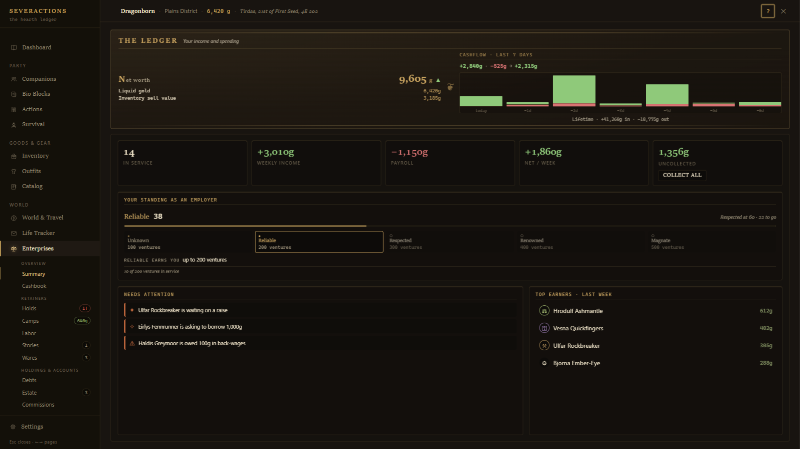
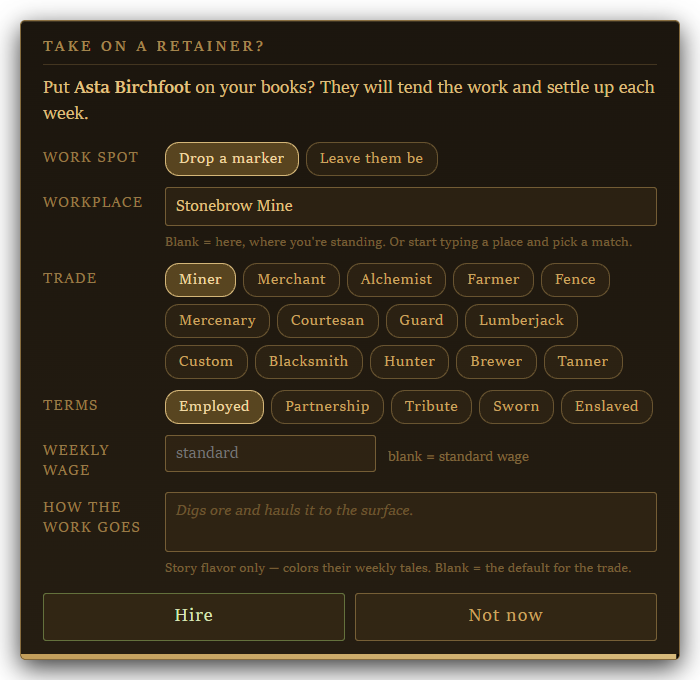
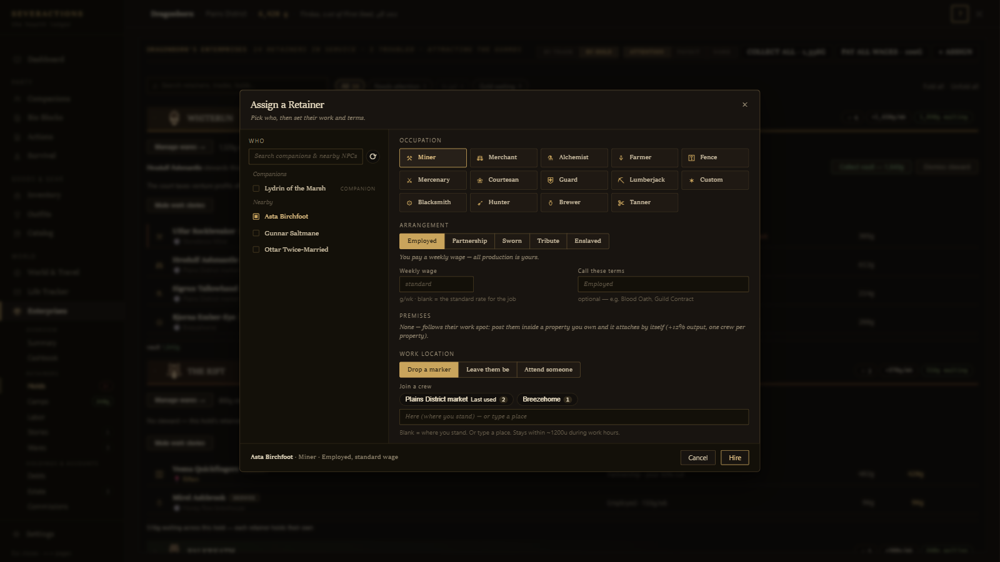
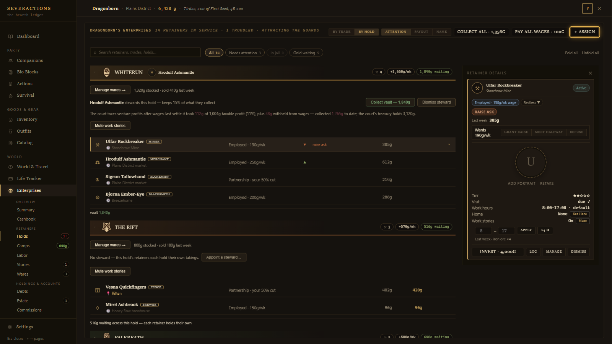
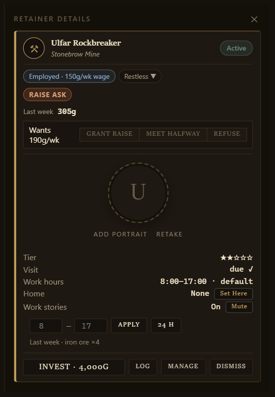
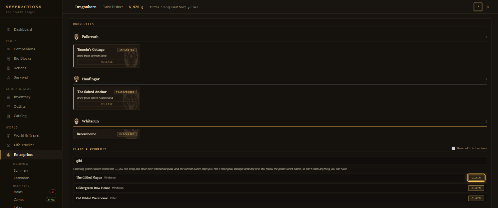
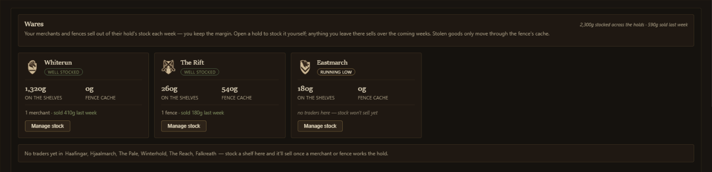
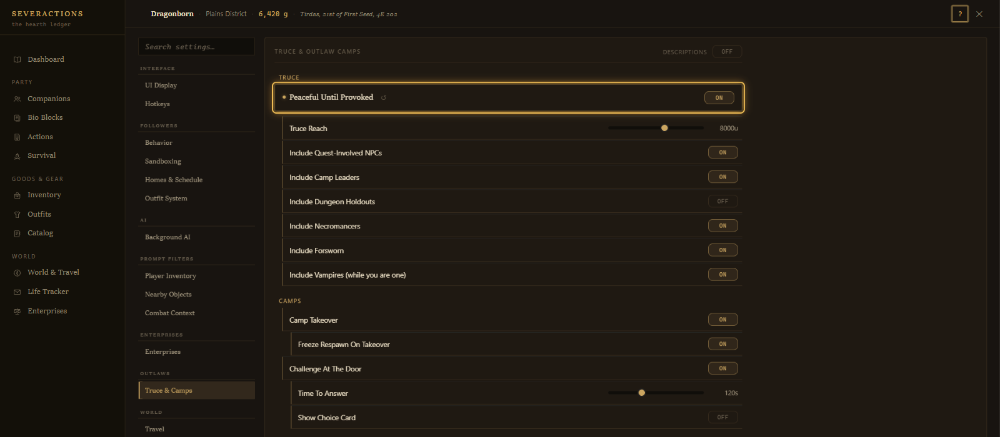
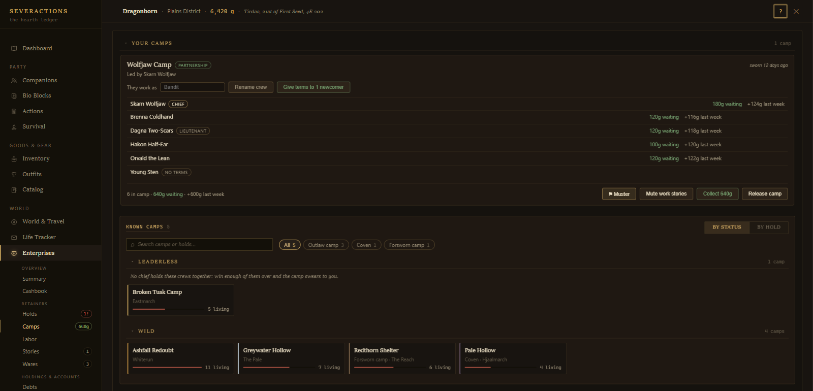

# Enterprises and Outlaws: A Player's Guide

*Written for SeverActions 4.7. Every picture here is an example built from made-up people, places and numbers.*

This guide covers the two systems players ask about most:

- **Enterprises:** putting NPCs to work for you, getting paid, and owning property.
- **Outlaws:** talking to bandits instead of fighting them, and making a camp work for you.

| I want to... | Go to |
|---|---|
| Hire someone | [How do I hire someone?](#how-do-i-hire-someone) |
| Get paid | [How do I get paid?](#how-do-i-get-paid) |
| Get a house or building | [How do I get a property?](#how-do-i-get-a-property) |
| Talk to bandits | [First, turn on the truce](#first-turn-on-the-truce), then [How do I talk to bandits?](#how-do-i-talk-to-bandits) |
| Make a camp work for me | [How do I make a camp work for me?](#how-do-i-make-a-camp-work-for-me) |
| Fix something | [Why isn't this working?](#why-isnt-this-working) |

## Before you start

**Open the menu.** Press **Shift+8**. You can change the key in Settings → Hotkeys.

**Check your install.** One option you need is not ticked by default.

| Installer option | Page | Ticked by default? | What you lose without it |
|---|---|---|---|
| **Enterprises Actions** | Action Modules | **No, tick it yourself** | Everything done by talking: hiring, stewards, raises, and every camp oath. You can still hire with **+ Assign**, but no camp can swear to you. |
| Combat Actions | Action Modules | Yes | The outlaw's verdict when they question you at a camp. |
| Basic Actions | Action Modules | Yes | NPCs handing you a property in conversation. |
| Core Awareness Prompts | Prompt Modules | Yes | NPCs knowing they work for you, or that they are in a standoff. |

If you skipped Enterprises Actions, run the installer again and tick it.

**Know how talking works.** There are no fixed dialogue lines. The AI plays each NPC and acts when a matter is truly settled in that conversation, so:

- **Say plainly what you want.** Name the job and the pay.
- **Get a clear yes.** "Maybe later" and "let me think" do nothing, on either side.

The sample lines in this guide are ideas, not magic words.

---

# Part 1: Enterprises

## The idea in one minute

An NPC you hire becomes a **retainer** who runs a **venture** for you: a mine, a stall, a forge. Every **7 in-game days** each venture **settles**. It earns gold and goods, pays any wage, and sets your share aside until you collect it.

All of this lives on the **Enterprises** page of the menu.

*Example with made-up data: the Summary page shows your income, your standing as an employer, and what needs your attention.*

| Tab | What it is for |
|---|---|
| **Summary** | Income, payroll, renown, and anything that needs attention. |
| **Cashbook** | Where your gold came from and where it went. |
| **Holds** | The main screen. Hire, collect, and manage every retainer. |
| **Camps** | Outlaw camps. Appears once the truce has met a camp. |
| **Labor** | Who works for whom across Skyrim. NPCs pay each other here and you take no cut. |
| **Stories** | Each retainer's weekly journal, written by the AI. |
| **Wares** | The goods your people produce. Appears once you have a retainer. |
| **Debts** | Money owed either way. |
| **Estate** | Your properties. |
| **Commissions** | Crafting orders you have placed. |

## How do I hire someone?

Hiring is free. The only cost is the weekly wage, if the terms have one.

### By talking

This needs **Enterprises Actions**.

1. Offer the NPC the work. Name the job and how they get paid.

   > "Run a stall in the market for me. I'll pay you a weekly wage."

2. When they agree, a card appears with the job and terms filled in.
3. Check it, then click **Hire**. **Not now**, Escape, or letting the 90-second timer run out cancels the hire.

*Example with made-up data: the card that appears when an NPC agrees to work for you.*

| On the card | What it does |
|---|---|
| **Work spot** | **Drop a marker** posts them at a spot. **Leave them be** lets them keep their own routine. |
| **Workplace** | Leave blank for where you are standing, or type a place. |
| **Trade** and **Terms** | The job and the money. See [Which job and terms should I pick?](#which-job-and-terms-should-i-pick) |
| **Weekly wage** | Leave blank for the standard wage. On Partnership and Tribute this box becomes **Your cut %**, and blank means the default share. |
| **How the work goes** | Flavor for their weekly stories. It changes nothing else. |

In VR, or with **Immersive Mode** on, there is no card. A clear agreement hires them on the spoken terms at the standard wage, and you can adjust it later with **Manage**.

### From the menu

This works without any conversation.

1. Stand near the NPC. Your companions are always listed, and people nearby appear too.
2. Open **Enterprises → Holds** and click **+ Assign**.
3. Tick one or more people. Everyone you tick gets the same terms.
4. Choose the occupation, arrangement, pay and work location, then click **Hire**.

*Example with made-up data: + Assign lets you hire several people at once.*

You can also use **Actions → Followers → Assign Work**, which opens the hire card for whoever you pick. That is handy when the conversation is not going your way.

## Which job and terms should I pick?

### Jobs

Base gold is a typical week at tier 1. Real weeks swing up and down with loyalty, luck and the occasional bad week. The standard wage is half the base.

| Job | Base gold a week | Standard wage | Goods |
|---|---:|---:|---|
| Mercenary | 600 | 300 | Now and then |
| Merchant | 500 | 250 | Now and then, and sells from the hold's shelves |
| Fence | 450 | 225 | Now and then, and sells stolen goods. Illegal. |
| Courtesan | 400 | 200 | Now and then, and sometimes pilfered valuables |
| Blacksmith | 400 | 200 | Some every week |
| Alchemist | 350 | 175 | Some every week |
| Guard | 350 | 175 | Now and then |
| Custom | 350 | 175 | Name your own trade. No goods of its own. |
| Miner | 300 | 150 | A big haul every week |
| Brewer | 300 | 150 | Some every week |
| Lumberjack | 250 | 125 | A big haul every week |
| Hunter | 250 | 125 | A big haul every week |
| Tanner | 250 | 125 | Some every week |
| Farmer | 200 | 100 | A big haul every week |

**Merchants and fences need stock.** Their income depends on what they sell, so empty shelves mean a poor week. See [Wares](#wares-selling-your-goods).

### Terms

| Terms | You pay | You get | Good for |
|---|---|---|---|
| **Employed** | A weekly wage | Everything left after the wage | Most hires |
| **Partnership** | Nothing | A share of the take, 50% by default | Friends and equals |
| **Sworn** | A weekly wage | No gold and no goods | A bodyguard, servant or gate guard |
| **Tribute** | Nothing | A cut paid under duress, 70% by default | A coerced deal. They resent it. |
| **Enslaved** | Nothing | Nothing | Held and unpaid. They earn you nothing. |

- **Sworn and Enslaved retainers produce nothing.** This is by design, not a bug.
- You can set your share anywhere from 5% to 95%, on the hire card, in **+ Assign**, or later with **Manage**.
- A partner starts pushing back once your share reaches 65%.

## How do I get paid?

**Gold** stays with the retainer until you collect it.

**Goods** go by themselves into their hold's wares chest, on the **Wares** tab. A fence's goods go into the hold's fence cache.

To collect gold, do any of these:

- Click **Collect all** at the top of **Holds**.
- Click **Collect** on a retainer's row.
- Ask them in person. The Actions page's **Collect Earnings** does the same.

  > "Hand over what you've earned since I last came by."

*Example with made-up data: the Holds page groups retainers by hold. **+ Assign** is highlighted at the top right, and clicking a row opens that retainer's details.*

**Wages come out of the week's earnings first.** Your own gold only covers a shortfall, and only the gold you are carrying counts. Keep some on you, or a slow week becomes unpaid wages.

### Making a venture earn more

- **Invest** in the retainer's details raises their tier, which means more output and better goods. It costs 2,000 gold times their current tier, and tier 5 is the top. New hires start at tier 1 to 3 depending on their level.
- **Post people together.** Retainers at the same work spot form a crew. These pairs earn a bonus: Miner and Merchant, Miner and Blacksmith, Farmer and Alchemist, Farmer and Brewer, Hunter and Tanner. A crew of 3 or 4 earns a little more, but a crew of 5 or more earns no bonus.
- **Add muscle.** A Guard or Mercenary in a crew means fewer bad weeks and slower pilfering.
- **Use a property you own.** See [How do I get a property?](#how-do-i-get-a-property)
- **Keep them happy.** Loyalty changes output, and an unhappy retainer works less.

## How do I keep retainers happy?

Open a retainer's details from their row on **Holds**. Anything that needs an answer shows up here and on **Summary**.

*Example with made-up data: this miner wants a raise, so the details offer Grant raise, Meet halfway and Refuse.*

| You see | It means | What to do |
|---|---|---|
| **RAISE ASK** | They want better pay. | **Grant raise**, **Meet halfway** or **Refuse**, or settle it face to face. Refusing costs loyalty, and repeated refusals lead to skimming. |
| **TERMS ASK** | A Tribute payer is balking. | **Ease terms**, **Meet in middle** or **Hold firm**. |
| **OWED** | You could not cover their wage. | **Pay wages**, or **Pay all wages** at the top of Holds. |
| **SKIMMING** or **SKIM?** | They are pocketing part of your take, or you suspect it. | A raise stops it. If they have no ask open, agree better pay in person or use **Actions → Employment → Grant a Raise**. A visit may catch them and recover the gold. |
| **WITHHOLDING** | A Tribute payer is holding back part of what they owe. | **Ease terms**. If they have no ask open, agree better terms in person or use **Actions → Employment → Grant a Raise**. |
| **NOTICE** | They quit next week. | A raise, **Meet halfway** or a real talk withdraws it. Paying back wages alone may not. |
| **DEFIANT** | A Tribute payer is keeping your whole cut. | Collect from them in person while they still hold gold or goods. The menu button will not work. If they hold nothing, ease their terms in person instead. |
| **LOAN** | They want to borrow gold. | **Grant loan** or **Refuse**. They repay from their own take, not your cut. |
| **DEFAULTED** | They missed 3 loan payments. | Repayments stop and they still owe you, but nobody collects it for you. **Forgive loan** in **Manage** clears it and buys loyalty. |
| **JAILED** | The guards have them. | **Bail**, which is free if they owe no bounty. |
| **Expected** | You sent word that you are coming. | Go and talk. Skipping the meeting makes things worse. |

Two small habits go a long way:

- **Visit them.** Stay near their work spot for about 10 seconds. Once every 7 days per retainer, this lifts their mood, adds renown, and may catch a skimmer. The **Visit** line in their details shows when one is due. Someone left with no work spot can't be visited this way.
- **Send word.** When someone is unhappy, their details offer **Send word** (**Summon them** on coerced terms). Click it, then go and hear them out. A sincere talk can clear a grievance and withdraw a notice. Brushing them off makes it worse.

### What if I can't pay?

If neither the week's earnings nor your purse covers a wage:

1. **First miss:** they are marked **Troubled** and you owe back wages.
2. **Second miss:** they move to **Grace**.
3. **Third miss:** they desert. Uncollected gold is lost, and they take what you owe them from the gold you are carrying.

A good week in between does not reset this. The count only clears once you have paid off the back wages.

Someone you wronged may then hire a few thugs to find you out on the road. The thugs stop to talk first, so you can pay, bluff or intimidate your way out. **Retainer Grudges** in Settings turns this off.

**Dismiss** is the clean way to part. It is amicable, but it drops their uncollected gold and any back wages you owed them.

### Fences

A fence earns well and draws attention. They build up heat, which becomes a bounty on **them**, not on you. Each week a fence with a bounty may be arrested and jailed, earning nothing until they are released. Pay off their bounty early, or **Bail** them out.

## How do I get a property?

There are three ways.

### 1. Buy or build a house the normal way

The mod spots these by themselves once you hold the house key or land charter:

Breezehome, Honeyside, Vlindrel Hall, Proudspire Manor, Severin Manor, Lakeview Manor, Windstad Manor, Heljarchen Hall.

**Hjerim is not detected, and neither are houses from other mods.** Add those with a claim (way 3).

### 2. Have someone hand it over

Ask for it in conversation. The AI decides whether they agree, so give them a reason: a Jarl rewarding great service, or an owner giving up their home or business.

> "I've bled for this hold, Jarl. Grant me the deed to that house by the market."

Only these people can give a property away:

- its owner
- a member of the household or guild that owns it
- the Jarl of that hold

A steward or housecarl can't give one away on the Jarl's behalf. Name the building, or stand inside it with them. You will see "*Name* transferred *place* to you", or "*Name* doesn't own *place*" if they had no right to give it.

Anyone living there keeps their place. **Actions → Property → Transfer Ownership** does this by hand, with the same rule about who can give it.

### 3. Claim it yourself

1. Open **Enterprises → Estate**.
2. Under **Claim a property**, type at least two letters of the building's name.
3. Click **Claim**.

Claiming is free and nobody needs to agree. It suits roleplay, and houses the mod cannot detect. Tick **Show all interiors** if the building is not listed.

*Example with made-up data: your properties by hold, with the Claim a property search below.*

### What does owning a property get me?

- **Sleep and store there** without trespassing. The current owner stays put.
- **A business bonus.** Post a retainer inside a property you own and their venture gets **+12% output**, with no setup. Everyone posted there is one crew.

**A property is not a safe.** Ordinary buildings still follow the game's reset timers, so don't stash anything you can't lose.

**Release** gives a transferred or claimed property back to its previous owner, and any business bonus there ends. Houses you bought have no Release button. The badge on each property (Transferred, Purchased, Inherited) is only a label, and clicking it changes the wording.

## Stewards: collect a whole hold in one stop

A **steward** is a retainer who gathers a hold's takings into one vault, so you make one stop instead of many.

- **By menu:** on **Holds**, click **Appoint a steward…** in that hold's section. You can seat any healthy retainer in any hold.
- **By talking:** offer the post to a retainer, who then stewards their own hold. Each hold has one steward, so nothing happens if the seat is taken.

The steward keeps **15%** of everything they collect. Their pay is that cut, not a wage, and your merchants in that hold sell a little better. Click **Collect vault** to take the rest, or ask them in person.

**Dismiss steward** hands the vault to you, and they carry on as an ordinary retainer. If a steward dies or deserts, they keep the seat and the 15% until you click **Dismiss steward**. A seat that shows as vacant has a **Recover** button for whatever is left in the vault.

Stewards also walk out to visit their people now and then. This is only for life and flavor, and **Recall** sends one home early.

## Taxes

Each hold's court taxes the weekly profit of each venture, after wages. The rates are brackets, so each one applies only to the gold inside it.

| Part of the week's profit | Rate |
|---|---:|
| First 100 gold | 5% |
| 100 to 500 | 10% |
| 500 to 2,000 | 15% |
| 2,000 to 10,000 | 25% |
| 10,000 to 50,000 | 35% |
| Above 50,000 | 45% |

That works out to about 8% on a 250-gold week and 12% on a 1,000-gold week. Tax is taken at settlement and never comes back. Your retainers' wages are taxed too, but that comes out of their pay, not yours.

**Not taxed:** fence income and sworn camps.

**A jarl can change the rate.** Argue your case in person. A jarl may ease their hold's rate by about 5 points, and insulting one may raise it by the same. The change can range from 15 points lower to 25 points higher, and no venture is ever taxed over 50%.

## Wares: selling your goods

Open **Wares** to see each hold's stock, or click **Manage wares →** on Holds.

*Example with made-up data: each hold's shelves, its fence cache, and what sold last week.*

- Goods your retainers produce land here without any help from you.
- Merchants sell from the hold's shelves each week, and fences from its fence cache. You keep the margin.
- Click **Manage stock** to take goods out or put your own in.
- Stolen goods sell only through the fence cache.
- A hold with no merchant or fence just stores its goods until one works there.

## Renown: how many people can I employ?

Your standing as an employer sets how many ventures you can run. It is on the **Summary** page.

| Standing | Renown needed | Ventures allowed | Also gives you |
|---|---:|---:|---|
| Unknown | 0 | 100 | |
| Reliable | 25 | 200 | |
| Respected | 60 | 300 | New hires start one tier higher, fairer raise and loan asks, and workers write asking for a job |
| Renowned | 120 | 400 | The same |
| Magnate | 200 | 500 | New hires start two tiers higher |

- **You gain renown from:** clean weekly settlements (+1 per venture, or per member for a sworn camp), raises you grant (+2), loans repaid (+3), site visits (+1), and camps sworn to you (+12 from a chief, +6 from a leaderless camp).
- **You lose renown from:** desertions (−5), defaulted loans (−5), a retainer betraying you to the law (−10), and each week a fence's bounty stays unpaid (−1).

At the cap, hiring pauses. Nobody is fired. A sworn camp counts as **one** venture however many people live there.

When someone writes asking for work, they appear on **Summary**. Find them and hire them as usual before their time runs out.

## Other things you may notice

**Imperial officers at the Blue Palace.** Once you have run a business and carry more than 10,000 gold, General Cassius Vero and two Legates take up residence at the Blue Palace in Solitude, and twelve Imperial soldiers begin patrolling five cities. In this version they stay at their posts and do not come to collect anything. To remove them, turn off **Imperial Levy** under Settings → Enterprises. They leave within seconds.

**Letters.** Couriers may bring you letters from retainers about raises and grievances.

**Weekly stories.** Each one is an AI call. Set how many under Settings → Background AI → **Weekly Retainer Stories**, or use **Mute** on a retainer, hold or camp. Gold and goods settle either way.

---

# Part 2: Outlaws

## First, turn on the truce

**The whole outlaw system is off by default.** Until you turn it on, bandits attack on sight as usual, and there are no camps to talk to or take over.

Turn it on in either place:

- **Menu:** Settings → Outlaws → Truce & Camps → **Peaceful Until Provoked**
- **MCM:** SeverActions → Combat & Outlaws → **Peaceful Until Provoked**

There is no restart, and outlaws near you calm down within a few seconds.

*Example with made-up data: Peaceful Until Provoked is highlighted. It is shown on here, but it starts off.*

Outlaws now hold their fire and stay wary. **This is a standoff, not friendship.** They have not surrendered and they will not treat you like a guard or a shopkeeper.

### Who the truce covers

| Group | With the truce on | Notes |
|---|---|---|
| Bandits | Covered | Includes camp chiefs and outlaws a quest is using. |
| Necromancers | Covered | Their raised thralls still attack. |
| Forsworn | Covered | The Markarth quest chain's Forsworn stay hostile. |
| Vampires | Only while **you** are a vampire | Cure yourself and they attack again. |

The truce does **not** cover:

- **Dungeons.** Outlaws in a barrow, crypt or Dwemer ruin fight on sight. Camps, forts, warlock lairs and the open road are all fine. To include dungeons, turn on **Include Dungeon Holdouts**.
- **Essential, protected and scripted NPCs.** These stay hostile as usual. An ordinary outlaw a quest is using does hold fire, so strike first. To change that, turn off **Include Quest-Involved NPCs**.

## How do I talk to bandits?

1. **Sheathe your weapon and walk up.** Standing there with your weapon away never runs out their patience.
2. **Talk.** Say why you are there and what you want.

   > "I'm not here for a fight. Who speaks for this camp?"

3. **Expect a hard bargain.** They may demand a toll, threaten you, trade, or tell you to leave. The AI plays them as outlaws, so what they accept depends on who they are and what you offer.

### What breaks the truce?

| What you do | What happens |
|---|---|
| You or a companion really hit one | The truce breaks. |
| Stand close with your weapon drawn | Their patience runs out, in about half a minute if you are in their face or about a minute nearby. |
| Sneak close while they can see you | The same. |
| Take anything from a camp's boss chest | The whole camp turns on you, even if nobody saw you. |

When it breaks, the outlaw turns hostile, and so does everyone under truce nearby and the rest of their camp.

If something outside your control keeps forcing an outlaw to attack you, such as another mod, the truce stops them a few times and then lets the fight happen.

**You can back out.** If they warn you, sheathe your weapon, stand up and step back, because their patience returns quickly. Staying armed in their face will end the talking.

Once broken, a truce stays broken for those outlaws until they unload. Leave the area and come back later.

## What if someone stops me at a camp?

Walk into the **interior** of a wild camp, such as a cave or fort, and the first outlaw who spots you comes over and demands your business. This is **Challenge At The Door**, and it is on by default.

- **Answer them in conversation.** You have 2 minutes by default.
- **If they let you pass,** the truce holds for the rest of that visit. The boss chest is still off limits.
- **If they run you off,** they attack and the whole camp joins in.
- **Walking away, stalling, or attacking** counts as a failed answer.
- **Sneak past unseen** and nobody asks.

Prefer buttons? Turn on **Show Choice Card**. Exterior camps do not do this, and ordinary truce rules apply there.

## How do I make a camp work for me?

You need three things:

- the truce on
- **Enterprises Actions** installed
- **Camp Takeover** on, which it is by default

The route depends on whether the camp has a chief.

| | Chief agrees | Nobody in charge |
|---|---|---|
| **When** | The chief is alive | The chief is dead, or the camp never had one |
| **Who must agree** | The chief alone | **3 members**, one at a time, or everyone left if fewer stand |
| **Terms** | Partnership | Vassalage |
| **Your cut** | 20% | 40% |
| **Renown** | +12 | +6 |
| **How it feels** | A bargain | They answer to you, and they may not like it |

### If the camp has a chief

1. Find the chief. Other members will not speak for the camp, so ask who leads.
2. Make your case and offer them something: protection, coin, or a reason to fear you.
3. Get a clear agreement that the whole camp will serve you.

   > "Swear your camp to me. You keep your ground, and I take a share."

You will see **The camp has sworn to you**.

### If nobody is in charge

The fight goes out of a camp when its chief dies. The survivors stand down, which gives you a way in.

1. Talk to the members **one at a time**, and win each one over.
2. Each yes counts once, and you will see a tally such as **Agreed - camp votes so far: 1/3**.
3. When enough have agreed, you will see **What is left of the camp answers to you**.

Camps with nobody in charge are listed as **Leaderless** on the Camps tab.

## Running a sworn camp

Open **Enterprises → Camps**. Your sworn camps come first, with the camps you know about below them.

*Example with made-up data: a sworn camp's card, then the other camps you have met.*

| Button | What it does |
|---|---|
| **Collect** | Takes everything the camp has earned. In a hold with a steward, the gold goes to the steward's vault instead. |
| **⚑ Muster** | Calls the camp to fight beside you. Those nearby join when you close the menu, and the rest travel to you. Members too far away to reach join when you next pass their camp. |
| **Send home** | Sends the war band back to camp. |
| **☆ chief** | Appoints a new chief. This shows when you point at a member's row. |
| **+ lieutenant** | Names a successor who steps up if the chief dies. |
| **Rename crew** | Changes what the crew is called. Their terms and earnings stay the same. |
| **Give terms to newcomers** | Puts new arrivals on the books now. This also happens by itself. |
| **Mute work stories** | Stops the camp's weekly stories. Gold still settles. |
| **Release camp** | A peaceful parting. Their ventures close and, while the truce is on, they do not turn hostile. |

You can also ask the chief in person to muster the camp or send it home.

**What swearing changes:**

- The camp keeps its ground and its work, and sends you your cut every week.
- It counts as one venture for your [renown](#renown-how-many-people-can-i-employ), however many people live there.
- It pays no hold tax.
- It stops respawning strangers, thanks to **Freeze Respawn On Takeover**.
- It stays at peace with you even if you later turn the truce off.
- Members also appear on **Holds**, under the camp's hold. Click a member's row to go there.

**Keeping the peace:**

- A stray hit is forgiven. A member only turns once **your own** hits have cost them a quarter of their health. Members mustered at your side always forgive you.
- If a chief dies, your first lieutenant takes over. With no lieutenant, the camp is leaderless until you appoint someone.
- A conquered camp (40%) grumbles under the yoke. It settles down at 20%, or if you appoint it a chief of your own.
- **Betray them and the chief can renounce the oath.** Killing their people or taking what is theirs can do it. The whole camp turns on you and this cannot be undone.

---

# Why isn't this working?

## Outlaws

**Bandits still attack me.**
- Check that **Peaceful Until Provoked** is on. It starts off.
- Are you in a barrow, crypt or Dwemer ruin? Those stay hostile unless you turn on **Include Dungeon Holdouts**.
- Did you or a companion hit one, or stand close with a weapon drawn? That truce stays broken until they unload. Leave and come back.
- If a spread-out camp charges you from far away, raise **Truce Reach**.
- Raised thralls, summons, and modded enemies outside the game's outlaw groups are not covered.

**There is no Camps tab.** It appears once the truce has met a camp, so turn the truce on and go near one. Places that count are bandit camps, forts, warlock lairs, Forsworn camps and vampire lairs. A barrow never counts as a camp.

**The camp won't swear to me.**
- Is **Enterprises Actions** installed, and **Camp Takeover** on?
- Are you talking to the chief? Other members can only point you at them.
- With nobody in charge, you need three different people, and one person's word counts once.
- The action never fires in combat, or while they are still bargaining. Get a clear yes.

**A camp turned on me.** You probably failed or walked away from the challenge, attacked during it, or took something from the boss chest. Come back later and sneak or talk.

## Enterprises

**I can't hire by talking.** Check that **Enterprises Actions** is installed, or use **+ Assign**, which needs no conversation.

**The hire card never appeared.**
- Look on **Holds**, because they may already be hired. When the card can't open, the hire goes through directly on the agreed terms.
- In VR or Immersive Mode there is no card.
- They may already be your retainer, or you may be in combat.
- Someone who turned hostile can't be rehired until they cool off, which can take up to 30 days. Ordinary deserters can be rehired at once.
- You may be at your [renown](#renown-how-many-people-can-i-employ) limit.

**A retainer earns nothing.**
- **Sworn** and **Enslaved** retainers never produce. This is by design.
- The first settlement comes 7 in-game days after hiring.
- Look for a **Working without terms** section on Holds. Those people were posted to a workplace but never given a job. Click **Give them a job**.
- Jailed retainers and captives do not work.
- A merchant or fence with empty shelves has a poor week.

**Where are my goods?** On the **Wares** tab, in the hold's chest. They go there by themselves.

**The Collect button does nothing.** A defiant retainer must be collected from in person.

**My wages went unpaid, but I'm rich.** Only gold you are carrying counts, not gold in a chest.

**My house isn't on the Estate tab.** Hjerim and houses from other mods aren't detected, so claim them under **Claim a property**. For the others, you need the house key or land charter on you.

**"*Name* doesn't own *place*."** They have no right to give it away. Try its owner, someone from the household or guild that owns it, or the Jarl of that hold. A steward or housecarl can't do it on the Jarl's behalf.

# Settings at a glance

**Outlaws** are under Settings → Outlaws → Truce & Camps.

| Setting | Default |
|---|---|
| **Peaceful Until Provoked** | **Off** |
| Truce Reach | 8000 |
| Include Quest-Involved NPCs | On |
| Include Camp Leaders | On |
| Include Dungeon Holdouts | Off |
| Include Necromancers | On |
| Include Forsworn | On |
| Include Vampires (while you are one) | On |
| Camp Takeover | On |
| Freeze Respawn On Takeover | On |
| Challenge At The Door | On |
| Time To Answer | 120 seconds |
| Show Choice Card | Off |

**Enterprises** are under Settings → Enterprises.

| Setting | Default |
|---|---|
| Venture Output | 100% |
| Imperial Levy | On |
| Hold Taxes | On |
| Tax Scale | 100% |
| Steward Visit Frequency | About every 3.5 days |
| Retainer Raise Requests | On |
| Retainer Loan Requests | On |
| Retainer Grudges | On |
| Retainer Temperament Consequences | On |
| Renown Roster Cap | On |
| NPC Labor Market | On |
